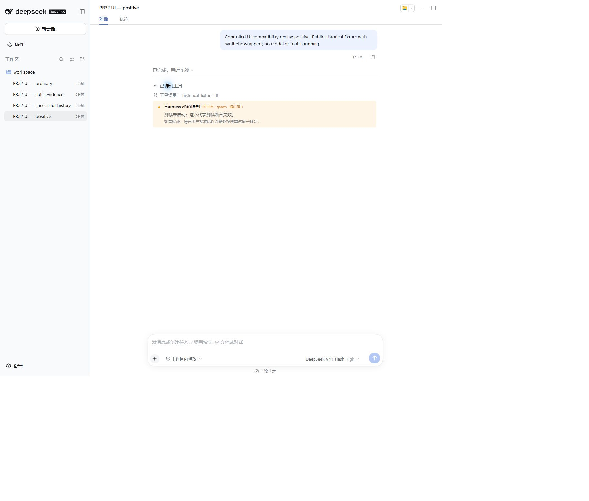
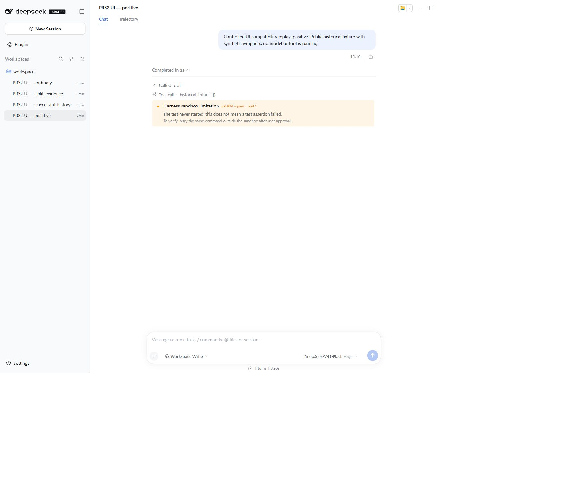

# Harness 0.2.0-rc.2 Web compatibility validation

PR #32 upgrades seven build-time Harness client/session packages from `0.1.2-rc.1` to `0.2.0-rc.2`. This report records actual Edge browser checks of a clean, isolated Harness `0.2.0-rc.2` Web profile on Windows, Node `24.14.1`.

The tested plugin source is PR #32 commit `c9166ca7c7b5509030aaa5512a13c1131715ee8a`. The PR was subsequently synchronized with main's type-only #33 update. The first browser pass installed the local build through the official CLI; a second pass installed the actual `npm pack` tarball through that CLI. The tested tarball SHA-1 was `743dcb54a0a5a37fb9a9c92444e2ffc7b556188c` before this documentation update.

## Evidence and limits

Four isolated v4 sessions were created with the official SessionStore and JSONL persistence services, and the current format catalog accepted all events under strict validation. Each session uses a clearly labeled synthetic lifecycle around the public historical `REAL_EPERM_OUTPUT` fixture in `test/fixtures/real-tool-result.ts`. No model, tool, paid API request, private session, or user credential was used. These checks are controlled UI replay, not four independent field reports.

| Check | Observed result |
|---|---|
| Current first-class `role: tool` result, six spawn EPERM stacks, `isError: false`, exit 1 | Exactly one Failure Lens note after the built-in tool row |
| Full historical stack, `isError: false`, exit 0 | Zero Failure Lens notes |
| Signature in one result and exit 1 evidence in another | Zero Failure Lens notes; two built-in tool rows retained |
| Ordinary successful output | Zero Failure Lens notes; built-in tool row retained |
| Chinese → English locale change | Title, meaning, advice, exit-code label and accessible evidence text changed immediately |
| Keyboard Enter on the built-in tool row | Original six stacks expanded and collapsed; plugin note contains only its summary |
| Reload and reopen the positive session | Exactly one note after expanding the step/tools groups; no duplicate registration |
| Official CLI uninstall, service restart and browser reload | Zero notes; original tool row retained |
| Packed tarball reinstall, restart and reload | Exactly one note returned |
| Browser console during initial checks and after the final restart | No captured warnings/errors in those windows |

Intentional server shutdowns during uninstall/reinstall produced expected connection-retry warnings in the browser. These were outside the healthy verification windows. Full screen-reader behavior, hot-disposal without restart, live model streaming, and migration of physical v3 files were not tested in this UI pass. Historical and current event shapes remain covered by the 43-test offline suite.

## Screenshots

Chinese warning, with the original tool row above it:

English warning after packed installation and restart:

The screenshots show the isolated local test workspace and public fixture replay only. No credential or authentication URL is included.
